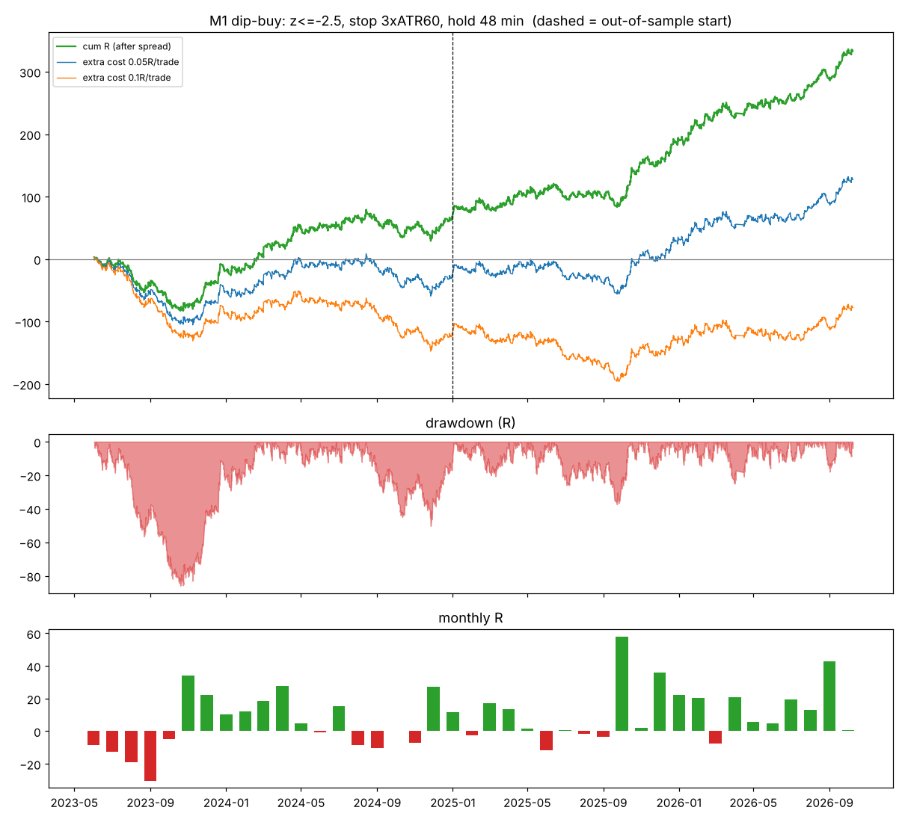
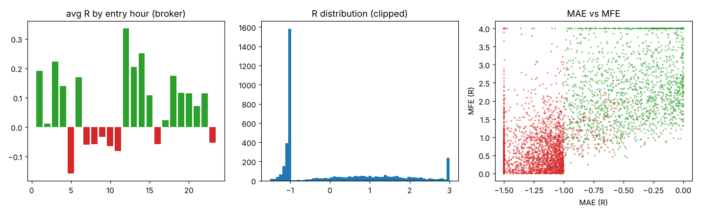

# XAUUSD M1 急跌買（v z-score 均值回歸）

> 資料：XAUUSD M1，2023/6/1 ~ 2026/10/8。時間一律為 **broker 時間（= 紐約 + 7）**。
> 參數在 2023/6 ~ 2024/12（樣本內）選出，**2025/1 ~ 2026/10 是樣本外**（第二十三部分，432 組中只依樣本內挑選）。
> 單位：美元/盎司 = 0.01 手的美元；bp = 損益 ÷ 進場價 × 10⁴；R = 損益 ÷ 停損距離。
> 重現：`python3 final_m1dip.py`（明細 `final_m1dip_trades.csv`、統計 `final_m1dip_stats.txt`、圖 `final_m1dip_equity.png`、`final_m1dip_breakdown.png`）。

---

## 1. 一句話
M1 上「價格速度」突然比過去一天的常態快很多地往下（z ≤ −2.5）時，下一根開盤做多，停損 3 倍 M1 ATR，最多抱 48 分鐘。
吃的是**急跌後的短線反彈**；勝率只有 40%，靠「賺的單平均 +1.7R、賠的單固定約 −1R」賺錢。

---

## 2. 交易規則

### 2.1 指標（每根 M1 收盤時計算）
| 名稱 | 公式 |
|---|---|
| TR | max(高 − 低, \|高 − 前收\|, \|低 − 前收\|) |
| **ATR60** | 最近 60 根 TR 的簡單平均 |
| Δ | 收盤 − 前一根收盤；若與前一根相隔 > 6 分鐘（週末、休市後第一根）→ 當成缺值 |
| **v**（速度） | EMA(Δ, span 20)（α = 2/21，不做起始修正）÷ ATR60 |
| **z** | (v − 最近 1380 根 v 的平均) ÷ 最近 1380 根 v 的標準差（1380 根 ≈ 1 個交易日） |

### 2.2 參數
| 參數 | 值 |
|---|---|
| 進場門檻 | z **首次**跌破 −2.5（上一根 z > −2.5、這一根 z ≤ −2.5） |
| 方向 | 只做多 |
| 進場 | 訊號那根收盤後，**下一根開盤市價買進** |
| 停損 | 進場價 − **3 × ATR60**（用訊號那根的 ATR60），進場同時掛停損單 |
| 出場 | 沒被停損 → 進場後第 **48** 根 M1 收盤時市價平倉（約 48 分鐘） |
| 停利 / 移動停損 | 無 |
| 同時持倉 | 最多 1 筆；持倉中出現的新訊號一律忽略 |
| 跨休市 | 48 根內會碰到休市（週末、每日休市）就不做 |
| 交易日 / 時段 | 全部（星期一 ~ 五、24 小時） |

### 2.3 每根 M1 收盤的操作流程
1. 更新 TR、ATR60、Δ、v、z（需要至少 1380 + 60 根歷史）。
2. 有持倉 → 檢查是否已滿 48 根，滿了就市價平倉；停損由掛單處理。
3. 沒持倉、且 `z_prev > −2.5 且 z ≤ −2.5` → 下一根開盤市價買進，掛停損 `進場價 − 3 × ATR60`。
4. 手數 = 帳戶 × 每筆風險 ÷（停損距離 × 100）。

### 2.4 參考程式（Python / pandas）
```python
tr  = max(high - low, |high - close.shift()|, |low - close.shift()|)
atr = tr.rolling(60).mean()
d   = close.diff().where(time.diff() <= 6min)
v   = d.ewm(span=20, adjust=False).mean() / atr
z   = (v - v.rolling(1380).mean()) / v.rolling(1380).std()
signal = (z <= -2.5) & (z.shift() > -2.5)
# signal[t] → buy at open[t+1]; stop = open[t+1] - 3*atr[t]; exit at close[t+48]
```

---

## 3. 整體績效（每筆 1 盎司，已扣進場點差）

| 項目 | 全期 | 樣本內 2023/6~2024/12 | **樣本外 2025/1~2026/10** |
|---|---|---|---|
| 筆數 | 4,106 | 1,874 | **2,232** |
| 每個交易日 | 4.8 | 4.7 | 5.0 |
| 勝率 | 39.5% | 39.3% | 39.7% |
| 平均賺 / 平均賠 | +1.73R / −1.00R | +1.69R / −1.03R | +1.77R / −0.97R |
| PF | 1.13 | 1.06 | **1.20** |
| **每筆期望** | +0.081R = +0.94bp = +0.34 美元/盎司（t 3.2） | +0.038R（t 1.0） | **+0.118R = +1.32bp（t 3.5）** |
| 總計 | +333R | +71R | +263R |
| 最大回撤 | **−86R**（2023/6~11） | −86R | −37R |
| 最長連虧 | 14 筆 | 14 | 14 |
| 正報酬月份 | 27 / 41 | | |
| 正報酬日 / 日 Sharpe | 49% / 1.75 | | |



### 3.1 逐年
| 年 | 筆數 | 勝率 | 每筆 R | 每筆 bp | 每筆美元 | 總 R | 停損距離中位 | 點差中位 |
|---|---|---|---|---|---|---|---|---|
| 2023（6 月起） | 684 | 38.6% | **−0.027** | +0.17 | +0.04 | **−18.6** | 1.02 | 0.18 |
| 2024 | 1,190 | 39.7% | +0.075 | +0.68 | +0.15 | +89.1 | 1.76 | 0.08 |
| 2025 | 1,314 | 39.8% | +0.092 | +1.11 | +0.41 | +121.3 | 3.44 | 0.07 |
| 2026（到 10/8） | 918 | 39.5% | +0.154 | +1.62 | +0.71 | +141.3 | 6.27 | 0.12 |

### 3.2 每月（總 R）
| 年 \ 月 | 1 | 2 | 3 | 4 | 5 | 6 | 7 | 8 | 9 | 10 | 11 | 12 |
|---|---|---|---|---|---|---|---|---|---|---|---|---|
| 2023 | | | | | | −8.6 | −12.5 | −18.8 | −30.3 | −5.0 | +34.3 | +22.3 |
| 2024 | +10.3 | +12.1 | +18.8 | +27.7 | +4.6 | −0.9 | +15.4 | −8.3 | −10.5 | +0.1 | −7.3 | +27.1 |
| 2025 | +11.5 | −2.3 | +17.2 | +13.6 | +1.4 | −11.6 | +0.6 | −1.7 | −3.4 | +57.9 | +2.1 | +36.1 |
| 2026 | +22.0 | +20.5 | −7.7 | +20.6 | +5.5 | +4.8 | +19.3 | +12.8 | +42.9 | +0.6 | | |

---

## 4. 交易細節

### 4.1 出場
| 出場 | 比例 | 平均 R | 勝率 | 平均持倉 |
|---|---|---|---|---|
| 停損 | 55% | −1.06 | 0% | 12.9 分（中位 8 分） |
| 時間到（48 根） | 45% | **+1.49** | 88% | 48 分 |

- 跳空穿過停損、以開盤價成交的只有 7 筆。
- 有一半以上的單會在 15 分鐘內被停損；撐過去的單 88% 會賺。
- 贏單的最大浮虧中位 −0.40R；輸單中有 25% 曾經浮盈 ≥ 1R（沒有停利，會吐回去）。

### 4.2 進場時段（broker 時間）
| 時段 | 筆數 | 每筆 R | 勝率 | 樣本內 | 樣本外 |
|---|---|---|---|---|---|
| 00-03 | 755 | +0.147 | 38% | +0.141 | +0.151 |
| 04-07 | 676 | +0.031 | 39% | −0.061 | +0.117 |
| 08-10（倫敦開盤） | 598 | **−0.052** | 35% | −0.122 | +0.015 |
| 11-13 | 445 | +0.170 | 44% | +0.167 | +0.172 |
| 14-16（紐約開盤） | 789 | +0.097 | 36% | +0.129 | +0.064 |
| 17-19 | 370 | +0.098 | 46% | +0.056 | +0.132 |
| 20-23 | 473 | +0.094 | 45% | −0.053 | +0.192 |

倫敦開盤（08-10）兩段都最差，但這是事後觀察，**沒有放進規則**。

### 4.3 星期、訊號深度、波動
| 星期 | 一 | 二 | 三 | 四 | 五 |
|---|---|---|---|---|---|
| 每筆 R | +0.035 | +0.079 | +0.100 | +0.054 | +0.140 |

| z | ≤ −4 | −4 ~ −3.5 | −3.5 ~ −3 | −3 ~ −2.5 |
|---|---|---|---|---|
| 筆數 / 每筆 R | 179 / +0.133 | 238 / +0.140 | 773 / +0.030 | 2,916 / +0.087 |

| ATR60 ÷ 過去一天平均（四分位） | 低 | 中低 | 中高 | 高 |
|---|---|---|---|---|
| 每筆 R | **−0.018** | +0.126 | +0.138 | +0.078 |

→ 盤很安靜時的急跌（ATR 偏低）沒有效果，同樣只是觀察、未放進規則。



---

## 5. 成本與風險

### 5.1 對成本非常敏感
| 每筆額外成本（滑價、手續費） | 全期每筆 | 樣本外每筆 |
|---|---|---|
| 0 | +0.081R / +0.94bp | +0.118R / +1.32bp |
| 0.02R | +0.061R（t 2.4） | +0.098R |
| 0.05R | +0.031R（t 1.2） | +0.068R |
| 0.10R | −0.019R | +0.018R |
| 1bp | −0.06bp | +0.32bp |

**損益兩平的額外成本 ≈ 0.08R ≈ 0.9bp ≈ 0.34 美元/盎司（以 2026 金價約為 0.4 美元）。**
停損單在急跌中常有滑價，實盤只要每筆多 1bp 就只剩樣本外那一段勉強為正。

### 5.2 帳戶模擬（1 萬美元、每筆固定風險、不複利）
| 每筆風險 | 總報酬 | 最大回撤 | 2023 / 2024 / 2025 / 2026 |
|---|---|---|---|
| 0.5% | +167% | **−42%** | −9% / +45% / +61% / +71% |
| 0.2% | +67% | 約 −17% | |
| 0.1% | +33% | 約 −9% | |

最大回撤 86R 出現在 2023/6~11（連續 5 個月虧損），所以**每筆風險不要超過 0.1~0.2%**。
停損距離隨金價與波動變化很大（2023 中位 1.0 美元 → 2026 中位 6.3 美元），手數要每筆重算；`final_m1dip_trades.csv` 的「建議手數」欄是 1 萬美元、0.5% 風險下的數字，風險改 0.1% 就除以 5。

---

## 6. 明細欄位（`final_m1dip_trades.csv`）
訊號時間、z、v、ATR60、進場時間、進場價、停損價、停損距離、出場時間、出場價、出場原因（停損 / 時間）、持倉_分鐘、點差、毛損益、
損益_美元每盎司、損益_bp、損益_R、最大浮虧（_R）、最大浮盈（_R）、建議手數_1萬美元_0_5風險、年、樣本（樣本內 / 樣本外）。

---

## 7. 已知限制
1. **優勢很小**：每筆約 1bp，跟點差差不多大；回測未計停損滑價與手續費。上線前必須先用模擬帳戶或極小部位，量測真實成交成本。
2. **2023 年是虧的**，回撤 86R、持續約 5 個月；樣本內整體 t 只有 1.0，樣本外 t 3.5，比較好的結果集中在 2025~2026。
3. 參數（門檻 2.5、停損 3、持有 48）是 432 組中依樣本內 t 值挑出的；同類設定（M1 急跌買）在樣本外 100% 為正，但仍有挑選偏誤。
4. 2025~2026 金價大漲，急跌被買回的機率可能偏高；去漂移後樣本外仍有 +1.14bp，但換到空頭年份可能變差。
5. 時段、ATR 高低的差異只是觀察，沒有做樣本外驗證，不要直接加進規則。
